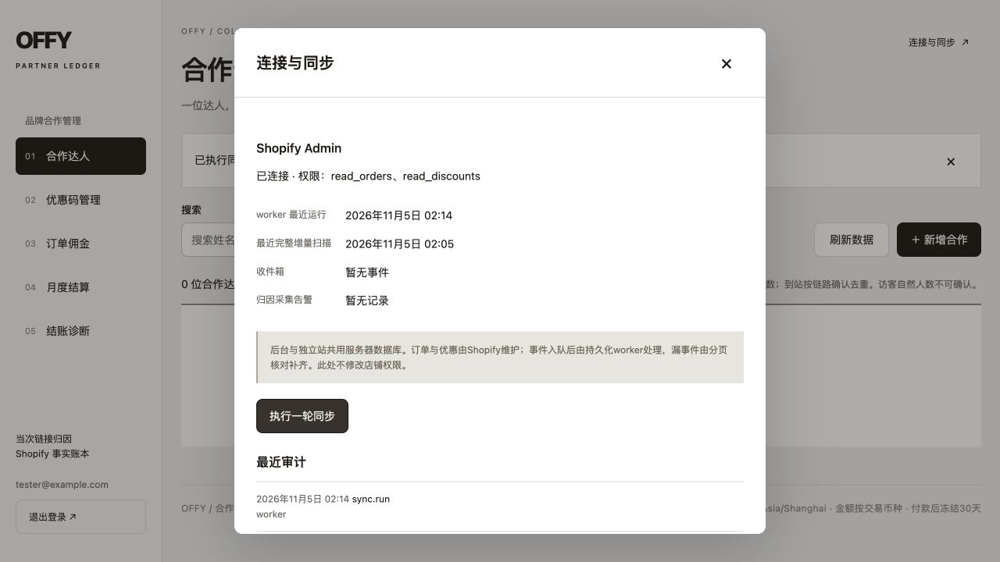

# Shopify Admin 自动认证验收

日期：2026-11-05。变更：`2026-11-05-admin-token-auto-renewal`。本记录覆盖代码实现与隔离验证，未修改线上 Shopify 应用配置、权限、订单或生产服务器运行配置。Git交付与服务器部署分别执行，不能把推送代码当作已完成生产发布。

## 实现边界

后台新增一次性服务器配置 `SHOPIFY_ADMIN_CLIENT_ID` / `SHOPIFY_ADMIN_CLIENT_SECRET`，完整 pair 优先于手动 `SHOPIFY_ADMIN_TOKEN`。自动令牌只保存在服务端内存，按 Shopify 响应有效期提前续取；并发请求共享交换任务，进程重启后按需获取。无凭据时本地后台及结账诊断仍可用，仅暂停远程任务。只填一项时报告配置不完整。

按请求开始时间计算硬有效期；提前 min(5分钟, TTL的10%) 续取。交换失败退避30秒，可以暂用仍有效且未被拒绝的缓存令牌；过期或401拒绝的令牌不再使用。自动模式401最多恢复并重放一次，其余HTTP/GraphQL/网络错误不重放业务操作。所有认证错误脱敏，不改变应用权限。

## TDD 与自动化

先增加令牌生命周期失败测试（缺少模块），再实现；部署预检与就绪检查测试先分别因未校验部分配置、未识别自动模式失败，随后接入实现。界面测试覆盖自动认证错误提示。

- 时钟/网络隔离测试：缓存、响应驱动的续期、24小时令牌提前5分钟续取、短TTL、并发、重启/配置变化、401合并恢复与上限、错误退避、拒用过期/被拒令牌、无权限/业务网络错误不重放、手动与无凭据模式、非法响应及目标域名、禁止重定向和敏感错误脱敏。
- 内存SQLite worker测试：无手动令牌时通过应用凭据恢复扫描；部分配置报错但不阻止本地记录；API/快照不输出凭据或令牌。
- 部署回归：后台单独构建/更新，不替换正在运行的主站；新凭据不要求主站匹配；预检只报告键名；只读就绪检查识别自动模式。

最终结果：

- `pnpm test --maxWorkers=2 --testTimeout=60000`：100个文件、674项测试全部通过。
- `pnpm typecheck`、`pnpm lint`：通过。
- 不含私密环境文件的独立源码/依赖副本中执行 `pnpm build`：lint、TypeScript检查、Turbopack编译、静态生成和standalone文件追踪均通过。
- 本次修改文件的Prettier检查、文档本地链接检查、`git diff --check`及严格OpenSpec校验：通过。

首轮同时执行构建/回归时出现既有部署脚本测试超时；停止并行构建后按上述并发与超时预算复跑整套成功。不修改测试断言、生产资源限制或项目默认测试配置。

## HTTP 与浏览器证据

测试使用 `OFFY_TEST_ADMIN_AUTH=automatic pnpm kol:integration` 创建系统临时目录和独立SQLite；模拟店铺只提供 `read_orders,read_discounts`，不连接真实 Shopify，不加载项目私密环境文件。12秒测试令牌用于实际HTTP续期验证，生产按 Shopify `expires_in` 执行。

`node scripts/shopify-admin-auth-integration.mjs` 通过：登录、权限读取、并发缓存、有效期后自动续取、401恢复、worker同步、主站创建结账链接、后台诊断访问、响应不包含凭据。`node scripts/kol-integration-checks.mjs` 的19项入口/认证/CSRF边界检查通过。

`node scripts/checkout-diagnostics-integration.mjs` 的正常、警告、HTTP失败、GraphQL失败、目录不可用、直达checkout、客户端预检失败7类场景通过；检查共库、链接加密、敏感查看审计、分页筛选、访问边界、认证、CSRF和SQLite完整性。

浏览器使用虚构测试账号登录，打开“连接与同步”读取两个只读scope，再点击“执行一轮同步”，成功提示及心跳更新正常。截图仅为本地模拟结果，不能当作生产部署或真实订单验证。

## 部署隔离与未完成的上线步骤

实际运行 `docker compose --env-file .env.example ... config --format json`，只用虚构凭据并以断言检查：新Client ID/Secret仅在admin环境，app、kol-worker及所有build args均无这两项；主站3000、后台3001的loopback映射保持不变。未输出完整Compose配置或真实秘密。

构建使用不含任何私密`.env`的临时源码和依赖副本。首次尝试的跨目录node_modules软链接被Turbopack拒绝，改用独立依赖副本；补齐根messages资源后再构建。原localhost:3000进程保持运行，构建不写项目`.next`。隔离验收服务结束后停止，测试数据仅存在临时目录，不进入发布数据库。

服务器需在私密运行文件中一次注入已安装应用的Client ID/Secret，再单独更新后台；本次未执行服务器部署。此前真实应用安装/只读访问验证与本次模拟续期证据分开，不宣称已实际等待24小时。应用卸载、密钥重置或授权撤销仍需处理；`write_discounts`未获批准，自动认证不会开启追加优惠码能力。操作见 [部署手册](deployment.md#配置-shopify-admin-连接可选)。
