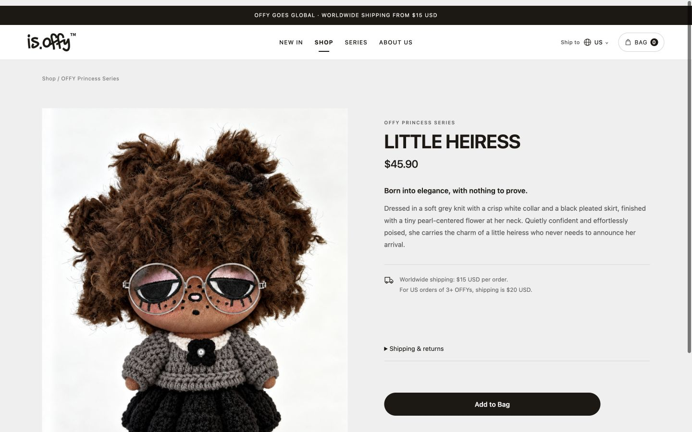

# 手机工具栏方案收敛验收

2026-11-11 用户要求撤回移除黑条和双行导航，保留更紧凑的手机第一行；随后确认侧栏底部Help & Support也保留。本次仅修订设计原型与说明；正式 Header、CartButton、MobileNav、字典及生产服务均未修改。上版本来没有上线，无需服务器回滚。

## 当前结果

- 原型恢复运费/赠品黑条，使用当前字典原文与原顺序。脚本验证实际轮播回调按4500ms配置在两条文案间切换；浏览器展示了恢复的黑条。总Header高度跟随换行测量，不再固化为100px。
- 320/375/390px：手机第二行隐藏，只有56px白色工具栏；购物袋44×44px，仅图标与数量，无BAG文字胶囊。三档均无横向溢出。
- 菜单恢复原有NEW IN / SHOP / 三系列 / SERIES / ABOUT US结构，同时保留Help & Support的Shipping & Returns、FAQ和Contact Us三入口。菜单打开与Esc关闭通过；保留的FAQ入口可进入本地帮助说明，未访问或修改真实业务数据。向下滚动455.5px后Header top仍为0，未出现第二行。
- 768/1440px：保留黑条和原桌面主导航，BAG文字胶囊可见。768px原型导航末端498.86px，国家按钮起点513.83px，无交叠及页面溢出。
- 系列子导航样式进一步收敛：去掉SHOP下方横线、分组竖线与三条子项横线，保留12px缩进及13px次级文字。390px和320px下三项边框均为0px、点击区均44px，文字无横向溢出；系列链接仍可进入原型中的系列页，Help & Support三项保留。仅更新侧栏截图，其他已保留的界面与业务不变。
- 本次全量Vitest回归通过：144个文件、903项；原型JavaScript语法、Prettier与OpenSpec检查通过。
- 原型及确认页JavaScript语法、格式检查通过；设计资源为已保存的只读样本，不请求Shopify管理页、不发送订单或广告事件。

旧版截图中展示的删除黑条/双行导航不再代表当前设计。本目录中的相关截图已更新或移除；旧方案仍可从Git历史查看。原归档方案仅保留历史，不作为后续实施依据。

[查看当前原型](http://127.0.0.1:8840/review.html)。从项目根目录运行 `node docs/design/mobile-header/serve.mjs` 可重开本地预览；不依赖真实Next.js服务。

后续若实施，只改手机工具栏的紧凑样式及侧栏帮助入口；黑条、主导航结构、桌面、国家判定、商品及支付链路保持原状。
