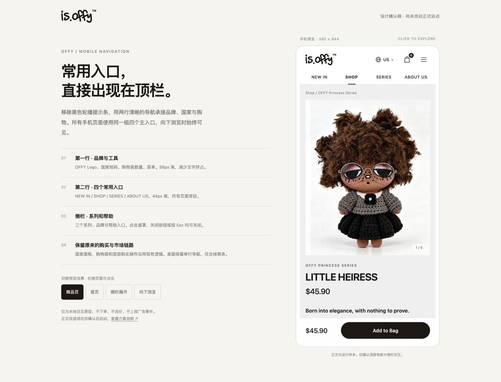
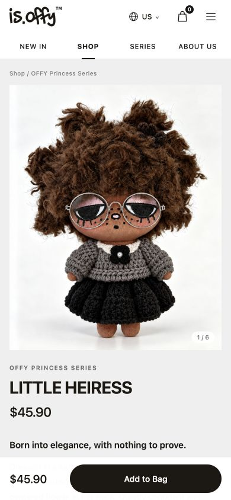
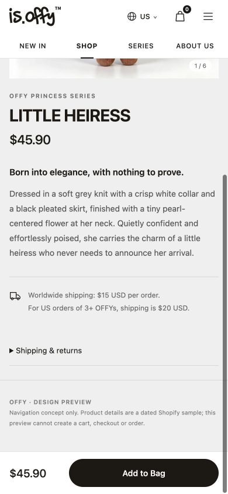
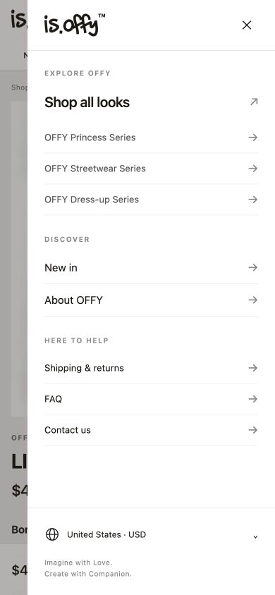
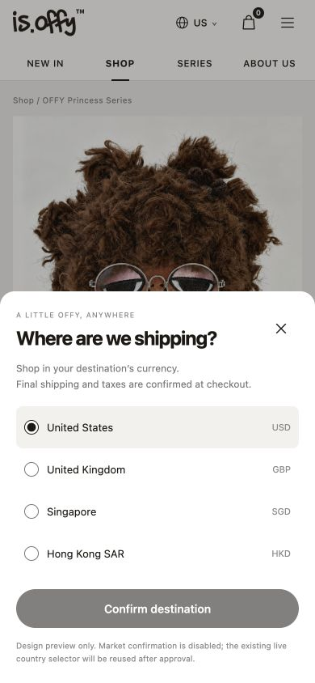
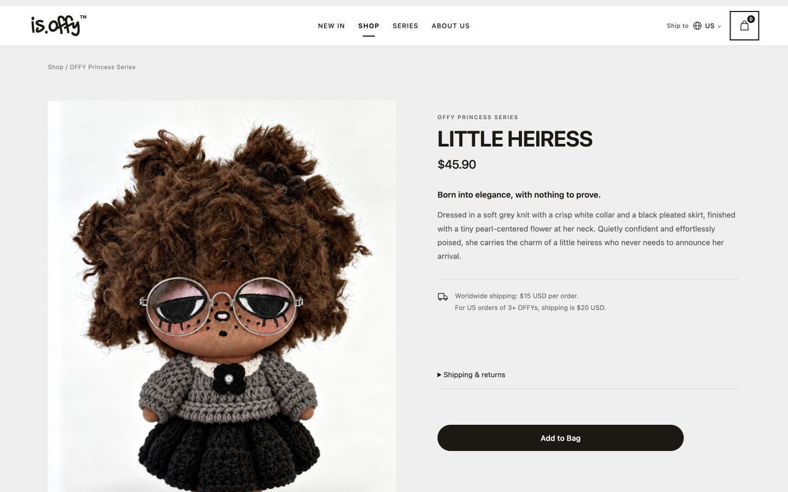

# 手机顶栏设计预览验收

日期：2026-11-11。状态：设计与原型完成，等待用户确认；没有修改 src/、正式字典、主站运行配置或生产服务。

## 验收范围

- 用户已明确第二行在所有手机页面常驻 NEW IN / SHOP / SERIES / ABOUT US。原型保持此选择，没有引入 Product / Review / Recommend 切换，也没有新增评论、收藏或分享功能。
- 黑色运费/赠品轮播条整条移除的效果只存在于原型；正式 Header 仍保留现有实现，待确认后再按 spec-first/TDD 开工。
- 当前商品上下文为只读 Shopify 的 LITTLE HEIRESS / US / USD 45.90 样本，时间和图片来源记录于 sample.json。图片是同一真实商品，未生成或编辑产品素材。它不参与任何运行时商业回退或结账。

## 静态检查

HTML 审计通过：lang、title、viewport、唯一 main、图片 alt、焦点与减少动态效果路径齐全。工具提示多 h1 与六个没有显式 aria-label 的按钮；各页面为互斥 hidden 场景，浏览器实测每个当前场景仅一个可见 h1；按钮均由可见文本命名，不是无名称按钮。原型与确认页 JavaScript 语法检查通过。

预览服务仅绑定 127.0.0.1，仅读取本目录与 public/assets；/.env 返回404，POST返回405。它没有订单、支付、邮件、广告、KOL或生产管理接口。国家确认明确禁用，只演示选择和取消；Add to Bag只弹出原型说明，不创建真实购物袋或订单。

仅有设计文档与原型，不运行正式应用的全量测试或构建来冒充实际改造验收；正式实现仍需另做其测试与浏览器回归。

## 浏览器检查

- 320 / 375 / 390px：Header总高度100px（第一行56px）；四个主导航常显，所有顶栏命中区高度至少44px，无页面横向溢出。
- 商品页向下滚动457px后，Header top仍为0，四入口及国家/购物袋仍在。底部原购买条的视觉位置保留。
- NEW IN、SHOP、SERIES、ABOUT US四入口分别可操作，切换后四个主导航始终可见。原型的NEW IN / SHOP使用同一示意目录，不新增真实的日期/销量排序规则。
- 侧栏开关、Esc关闭、背景锁定及焦点回到菜单按钮通过。国家面板从侧栏打开时只保留一个对话框，取消后焦点返回可见的Header国家按钮；未提交的UK选择在重开时恢复US样本，Header市场未改变。
- 空袋演示可打开并关闭，未调用实际购物袋逻辑。
- 768 / 1440px：恢复桌面单行导航，Header为72px内容+1px边框，菜单按钮隐藏，无页面横向溢出。
- 确认页四个场景切换可操作，手机预览嵌入390×844iframe，在电脑上也能直接看到手机布局。临时浏览器视口覆盖已重置。
- 浏览器扩展仍会注入Object类日志，未关闭或修改用户扩展设置；本地资源与已测试原型交互正常。

## 查看

从项目根目录执行：

```bash
node docs/design/mobile-header/serve.mjs
```

打开 [设计确认稿](http://127.0.0.1:8840/review.html)。原型没有依赖正在运行的 Next.js 或真实商店后台。








首页示意为已有品牌图的上下文拼接，不作为首页正文重新设计的授权。确认范围为顶栏、菜单与移除黑条；其他页面继续保留当前实现。
