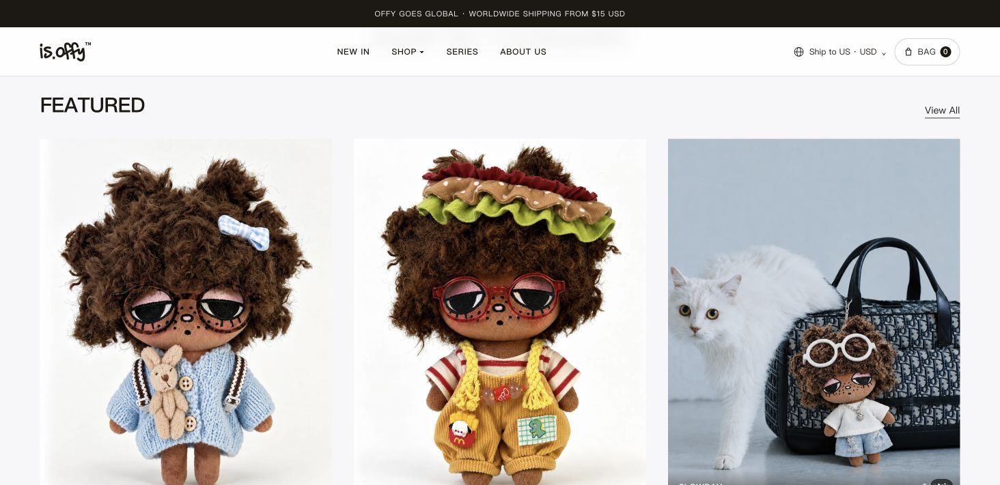
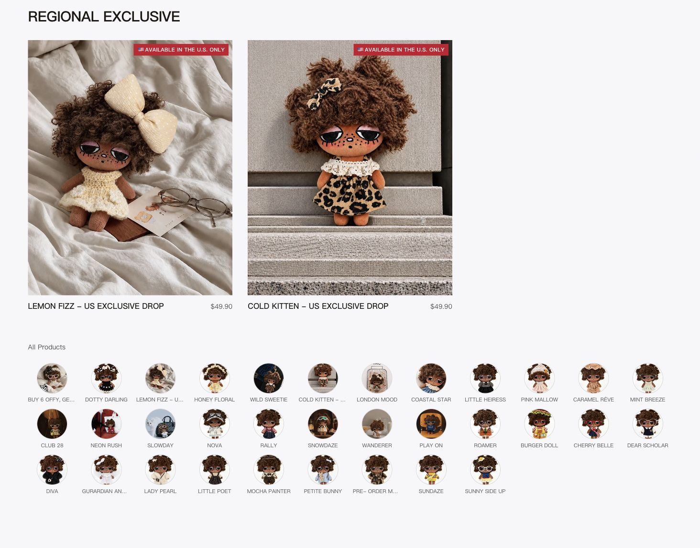
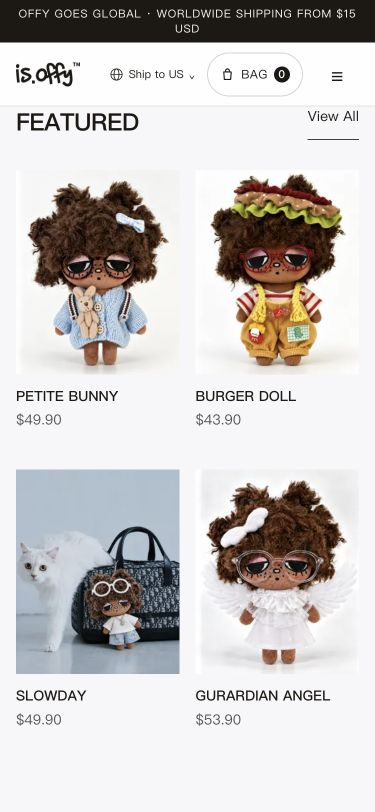

# 首页精选与原风格恢复验收（2026-11-11）

状态：用户否决了上一版扩大范围的视觉改版，本次恢复原风格并适配已创建的 FEATURED 集合；当前仍为本地截图确认阶段，**未部署生产**。配置规则见[选品说明](homepage-merchandising.md)。

## 本次修正

- 恢复原 Shop by Category 标题、container-site / section-y、大图 4:5 ProductCard、红色区域角标及桌面三列/手机两列。撤回方形 contain、1280px 收窄、区域侧栏和替代名册的三系列链接条。
- 主标题固定 FEATURED，限定区固定 REGIONAL EXCLUSIVE；共享同一标题 class、层级、字号和字重，均在各自网格上方。
- 恢复 All Products 的当前国家非周边商品圆形缩略图，全量展示，不受六款精选限制。完整目录与推荐独立读取：推荐故障不隐藏有效名册，目录故障不伪造名册。
- 只读核对 Shopify 集合名称 FEATURED、handle featured，代码由 home-featured 改为 featured。没有创建、修改或发布 Shopify 商品、集合、排序、市场或库存；原三系列和支付链路不变。

## 自动化证据

先写失败测试，复现固定标题/标题等大、原图片比例、完整名册及部分读取失败边界；另以真实 handle 断言复现仍读取 home-featured 的错误，再修改实现。

相关 55 项测试通过；最终全量 Vitest **144 文件、903 项通过**。首次与构建并行的全量运行有三项原部署脚本测试超时，未改测试或放宽超时；构建结束后以四个 worker 重跑，全量通过（117.33 秒）。TypeScript、ESLint、生产 standalone 构建通过，Next 构建阶段 67.8 秒。当前主规范和差异格式同时验证。

保留原有选品测试：集合顺序/六款上限、重复/缺货/非原系列/merch 排除、限定名额前补位、成功空集合、缺失/GraphQL/超时日期回退、原系列/区域判定失败。NEWS 五张本地宣传图的回归测试保持通过。

## 真实 Shopify 与浏览器

本地 standalone 关闭 Meta、CAPI、KOL 跟踪和 Admin 凭据，不启动 worker。直接只读当前 Shopify 数据，无模拟商品或模拟精选集合。通过本地测试入口指定 US；这些入口不进入仓库或发布镜像。

- 当前 FEATURED 读取成功。美国主区顺序为 PETITE BUNNY、BURGER DOLL、SLOWDAY、GURARDIAN ANGEL、DOTTY DARLING、WANDERER，与实际集合筛选顺序一致；金额及 USD 来自 Shopify。
- 美国限定区仅 LEMON FIZZ / COLD KITTEN，与六款精选无重复。All Products 为该次实时返回的 33 款非周边公仔；名册包含精选和限定商品，是完整商品索引。
- 桌面 1464px：两个标题均 30px、摄影比例 0.8（4:5），保持三列；375px 手机两个标题均 24px、两列每卡 163.5px；320px 无页面横向溢出、名册四列每格 63px。价格常显，链接回到原商品详情及目录。
- 本机原始 Shopify PNG 下载曾超过 Next 的 7 秒上游期限。截图预览进程临时允许相同 CDN 原图 45 秒下载，用于排除本地慢网干扰；不替换图片、不变更产品数据/渲染样式，不修改源码、依赖、生产配置或发布镜像；图片加载后已撤销临时网络夹具并用原进程复核，最终保留的预览不带此夹具。全部 41 张模块图片（6 张精选、2 张限定、33 张缩略图）加载完整。未将预热或本机网速作为线上图片时延保证。
- All Products 的 PETITE BUNNY 链接经键盘进入原商品详情，View All 实际进入 /products 的 All Looks。新开预览时也遇到 Shopify 只读请求超时，页面按规范保留品牌内容和一次重试提示；未用旧商品数据掩盖网络失败。
- 未执行加购、结账、付款、管理后台操作或生产部署。

## 当前截图

此前 fallback / curated 截图属于被否决的方形版，留作历史，不作为当前样式依据。

用户确认新截图后，再单独安排主站发布。
