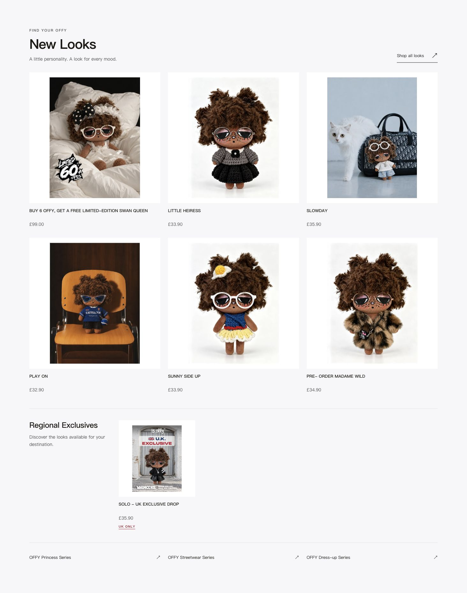
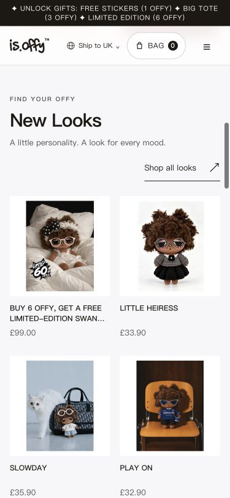
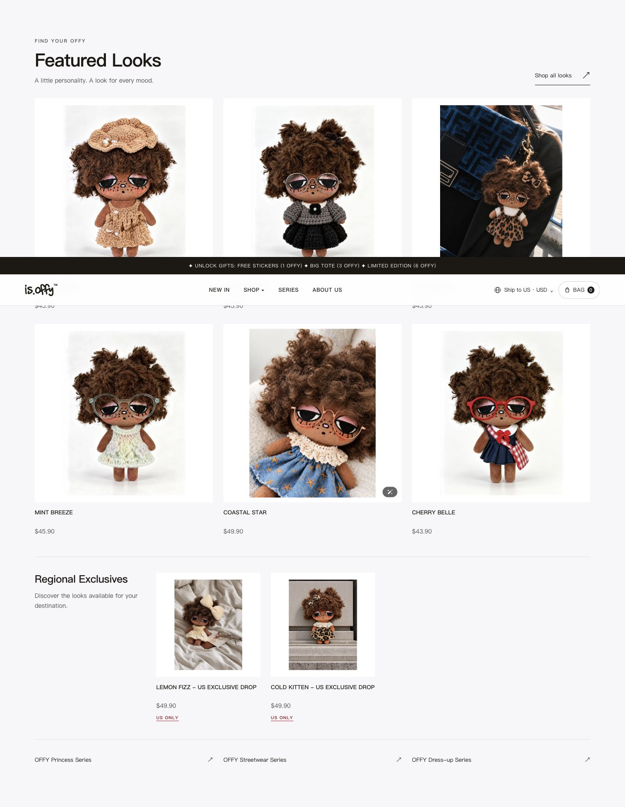
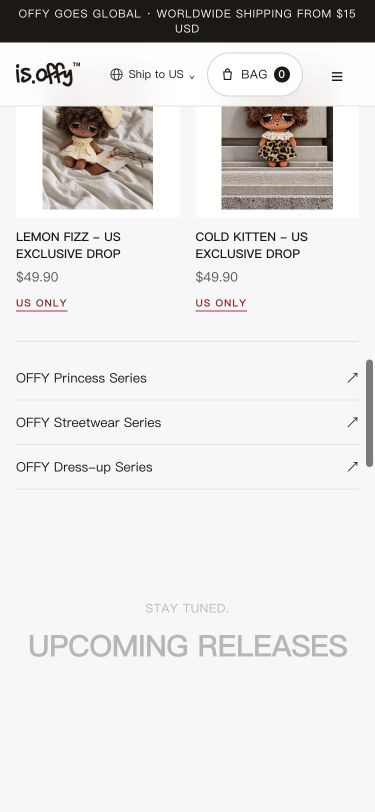

# 首页选品与界面验收（2026-11-11）

状态：实现与本地验收完成，等待用户截图确认；**未部署生产**，未配置 Shopify 首页精选集合。配置入口与规则见[选品说明](homepage-merchandising.md)。

## 自动化与构建

- Spec-first + TDD：先复现没有独立精选源、限定款未在限额前排除、区域读取失败被视为空的问题，再实现。新增组件先以缺失模块复现失败，再补齐渲染及边界。
- 最终全量 Vitest：144 个文件、903 项通过。TypeScript、ESLint、Prettier、差异空白检查及 production standalone 构建通过；最终构建 56.5 秒。
- 覆盖：手动集合顺序、六款上限、当前币种、重复身份、可售条件、周边和原系列归属、单/多国家限定、成功空集合、缺失/503/异常回退、原时间逻辑在取每系列两款前补位、数据源与区域判定失败。
- 原三个系列仍由原映射提供；测试额外加入 home-featured 后，系列导航仍只返回三个原系列。详情主系列规则未改。首页 NEWS 的五张内置宣传图回归测试保持通过。

## 动态验证环境与结果

两个隔离本地环境均关闭 Meta、CAPI 和 KOL 跟踪，没有启动订单/广告 worker。最终 standalone 直接读取真实 Shopify 数据，用本地只读入口设置 US/GB 目的地；测试入口不进入仓库或发布镜像。

精选分支使用单独本地 Storefront 适配器：从真实 Shopify 只读查询获取现有商品、价格、库存和图片，只在本机模拟 home-featured 的顺序及空/缺失/故障响应，不写 Shopify。适配器只接受查询，拒绝 mutation；其缓存仅用于这次本地测试，生产代码未引入持久商业缓存。

- 实际没有 home-featured 时，英国 New Looks 仍为每系列两款，共 6 款；SOLO - UK EXCLUSIVE DROP 仅在独立区域，价格 GBP、身份与主推荐无交集。US 回退同样不包含两个美国限定款。
- 模拟精选将 cold-kitten 放在首候选后，主区跳过该美国限定款，依次展示 warm-biscuit、royal-grey、wild-sweetie、mint-breeze、coastal-star、country-getaway。限定区保留 lemon-fizz 与 cold-kitten；真实名称、图片和 USD 价格均来自同次只读数据。
- 在浏览器分别模拟成功空集合、确认缺失、503 和国家判定不完整。空集合保留空态与目录入口；缺失/503 显示按时间选品的 New Looks；判定不完整时仅保留一个品牌化重试区，NEWS 独立有效内容仍展示。
- 三个系列入口实际打开后，其 H1 分别为 OFFY PRINCESS SERIES、OFFY STREETWEAR SERIES、OFFY DRESS-UP SERIES，路由保持不变。推荐卡片经键盘进入 CARAMEL RÊVE 的原商品详情，未加购、未创建 Checkout 或支付订单。
- 桌面 1440×900、手机 375×812、窄屏 320×640、平板 768×1024、宽屏 1920×1080 均无横向溢出；主区最大 1280px；桌面三列、窄屏两列。320px 主卡 136px；375px 主卡 163.5px；1920px 主卡约 410.7px，限定卡保持 240px，不随宽屏拉大。
- 真实英国截图的 7 张商品图全部加载完成，单个语义 H1 保留。名称、金额、导航始终可读；焦点轮廓及键盘操作已检查；减少动态效果的 CSS 路径保留。浏览器开发验证曾出现扩展注入的 monica body 属性 hydration 警告，未通过修改全局扩展设置掩盖；生产构建和新模块正常运行。
- 本地遗留的 LITTLE HEIRESS×2 测试购物袋已通过界面清理。真实服务器、商品/库存/价格/国家、订单、支付和管理后台未操作。隔离适配器和开发服务已关闭，仅保留本地 standalone 预览。

## 最终截图

尚未配置精选集合时的真实英国市场回退展示：

精选集合接入后的本地顺序样例（只模拟集合，不是在 Shopify 创建的真实运营配置）：

截图为本次商品取样，不把数量、价格或未来候选顺序固化为商业事实。用户确认样式后再单独安排主站发布。
