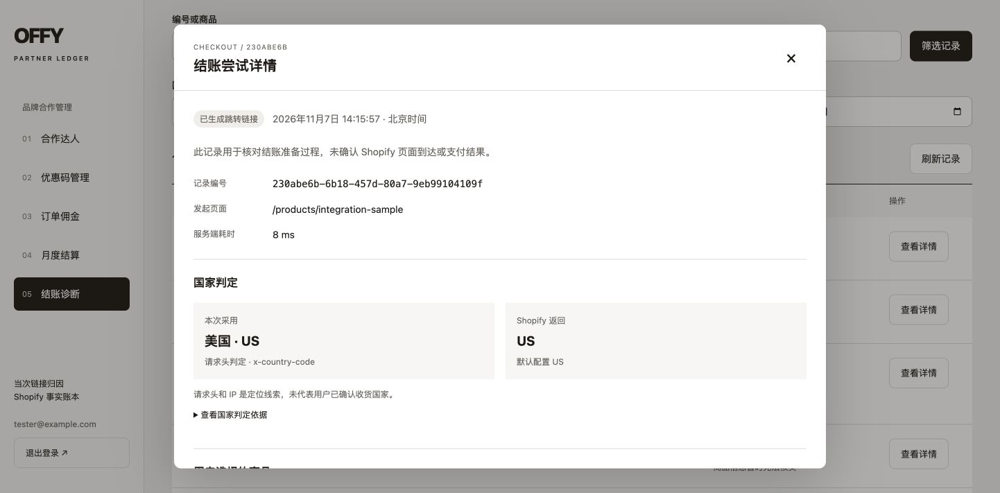
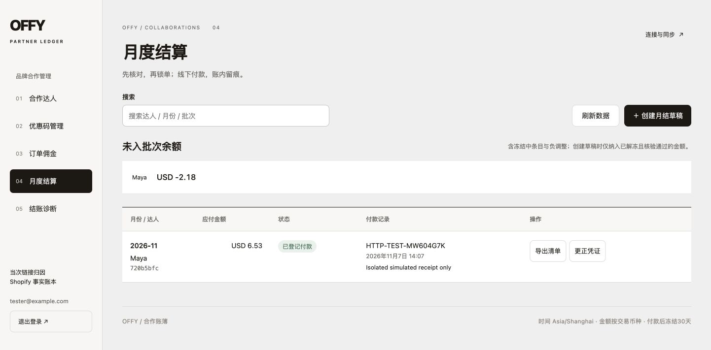

# Offy 管理后台完整链路验证记录

验证日期：2026-11-07，Asia/Shanghai。源码基线：`8711713bb68ee6d8ecd0b0a8d9a7b91e7fda9701`。生产 admin / worker 的功能版本为 `1fc8d09947f20dfb2c9417d4df60857ce756f34e`；这两个提交之间只有归档和验证文档差异，运行代码一致。本记录不修改业务实现，也不触发生产部署。

## 结论与边界

管理员认证、合作管理、当次链接归因、优惠码绑定与异步发码、订单核对、自定义佣金快照、冻结期、结算状态机、退款调整及结账诊断的核心逻辑通过本轮验证。真实 Shopify 的三笔不同场景订单与本地记录相符。不过，当前不能将结论表述为“生产全部功能已开放”：生产缺少写折扣权限和可追加代码的折扣活动，唯一合作已到期，正式结算开关关闭。

发现一项需要后续确认方案的购买链路风险：Shopify 返回商品不可售警告、购物车已空，但仍给出 checkout URL 时，当前实现记录诊断后仍跳转。另有到期状态展示和公网 worker 响应差异两项问题，详见后文。本次没有修改线上支付行为。

生产仅查看后台、Shopify 订单及折扣列表，读取服务健康和数据库业务摘要。所有新增合作、发码、模拟成交、退款、月结和付款登记均在本地隔离源码副本、临时数据库及 Shopify 模拟器中执行。没有在真实 Shopify 创建订单、优惠码、退款或付款，没有修改市场、库存、配送、应用权限、令牌、Nginx 或生产开关。

## 验证证据

| 层次                    | 实际结果                                                                 | 覆盖范围与限制                                                                                                                   |
| ----------------------- | ------------------------------------------------------------------------ | -------------------------------------------------------------------------------------------------------------------------------- |
| 全量自动化回归          | 100 个测试文件、687 项测试通过，87.69 秒                                 | `pnpm test --maxWorkers=2 --testTimeout=30000`；包括认证、归因、财务、诊断和组件测试；不等同于真实支付验收                       |
| 隔离 HTTP 边界检查      | 22 项通过；在自动凭据和手动模拟令牌模式各跑一次                          | 管理入口隔离、匿名拒绝、伪造入口、CSRF、会话、机器人点击、Webhook 验签、退出失效；两次执行不算 44 个不同用例                     |
| 隔离主业务流程          | 17 项通过                                                                | 异步发码、链接归因、费率快照、月结、付款后退款调整、仅用码不归因                                                                 |
| 隔离表单和异常扩展      | 64 项检查通过                                                            | 校验、唯一别名、代码保留、暂停链接、伪造票据、Shopify 错误和诊断读取；其中不可售警告继续跳转属于对现状的确认，不代表拦截保护通过 |
| 隔离财务状态扩展        | 35 项检查通过                                                            | 手动待核查与释放、付款凭证更正、重复付款阻止、30 天冻结、草稿和锁定批次取消、条目释放                                            |
| 浏览器操作              | 合作创建、可选社媒、完整模拟购物链路、诊断筛选与详情、原文查看、退出通过 | localhost 模拟成交，无真实扣款；原文查看在临时数据库产生一条 `checkout.reveal` 审计                                              |
| 真实 Shopify 与生产后台 | 三笔订单核对；连接权限、折扣活动、五个后台栏目读取通过                   | 只读，不进行真实写折扣、结算或退款测试                                                                                           |

临时 HTTP 扩展脚本在验证后删除；项目原有可复用入口为 [隔离测试环境](../scripts/kol-integration.ts)、[边界检查](../scripts/kol-integration-checks.mjs) 和 [业务流程检查](../scripts/kol-integration-workflow.mjs)。本轮没有新增或修改业务测试代码。

## 各模块结果

### 登录与访问边界

生产唯一管理员登录成功，本次独立会话结束后退出，页面恢复登录表单。公网独立站 `/admin` 和 `/api/admin/kol/state` 返回 404；后台独立入口未登录访问数据接口返回 401。没有退出用户其他浏览器已有会话。

隔离环境验证伪造入口、恶意 Origin、未登录请求和无效 Webhook 签名被拒绝；登录 Cookie 带 HttpOnly、SameSite=Strict，管理响应不缓存，退出后原会话失效。生产使用 HTTPS；本地 HTTP 模拟不代替生产 TLS 验收。

### 合作管理与链接统计

浏览器创建 Maya 时只填写一个 KOL 名称，社媒主页留空可提交，自动生成唯一推广别名。接口补测同名生成不重复别名，既有别名不能修改；佣金 0% 和 100% 可用，超范围和超过两位小数被拒绝。非法主页 URL、结束早于开始、站外推广落地地址被拒绝。

暂停合作后推广入口返回 410，计数不增加；伪造访问票据无法确认为有效访问。浏览器从 `/r/maya` 进入、确认访问并清除临时参数后购买，订单可验证地归因 Maya。机器人与 HEAD 请求不计入有效访问。仅使用优惠码、没有本次链接票据的模拟订单不归因，不产生 KOL 佣金。统计中的请求、确认访问、结账尝试和成交是不同口径，不能混为用户数。

生产 Maya 的保存状态是 active，但合作期为 2026-11-04 至 2026-11-05，验证时已到期；没有为测试延长合作。

### Shopify 认证及优惠码

隔离自动凭据模式验证：模拟 access token 到期后可重新获取；模拟一次 401 后可重新获取并恢复请求。使用受控的 12 秒测试令牌验证更新逻辑，没有故意使生产凭据过期或撤销授权。

绑定已有码时会标准化大小写；同一码不能同时给另一 KOL，结束本地绑定后仍不能转给其他 KOL。生成新码先进入异步任务，远端确认和读回后才成为已绑定。缺少 `write_discounts` 时返回明确错误且不创建任务。完整发码写入流程使用具备模拟写权限的本地环境通过，没有增加生产权限。

真实 Shopify 折扣页显示三项有效的自动 Buy X Get Y 活动：BUY6 OFFY FREE SWAN QUEEN、BUY3 OFFY FREE TOTE BAG、BUYANY OFFY FREE STICKER。自动折扣不是后台“向既有优惠码活动追加代码”所需的 code discount campaign，当前没有可选择的此类活动。生产连接目前只有 `read_orders`、`read_discounts`，所以生成代码也会被写权限门槛阻止。绑定真实已有码需要先有实际存在的码。本次没有创建或停用任何真实折扣。

### 订单、佣金与结算

完整模拟流程以商品净额 USD 90、7.25% 费率生成 USD 6.53 佣金。结账后将当前佣金改为 12%，订单仍使用创建结账时的 7.25% 快照。之后恢复测试合作条款；整个隔离库最终删除。

未满 30 天不能进入结算；模拟成熟后可创建草稿、锁定并登记测试付款。这里的付款是账本登记，未发起真实转账。付款后模拟退款 USD 30，当前净额变为 USD 60，目标佣金 USD 4.35，形成 USD -2.18 后续调整，已付款批次和 CSV 金额保持原 USD 6.53。凭证更正也不会改写已付金额快照。

手动标记待核查需要原因，释放后恢复核验；已付批次不可取消或再次付款，空付款凭证被拒绝；未付款草稿及锁定批次可按规则取消，取消后条目可重新进入草稿。不同币种分开结算，未进行混币加总。

真实 Shopify 只读对账结果如下。金额不包含顾客个人资料，不将支付手续费或换汇后的收款额当作商品净额。

| 订单  | Shopify 事实                                                               | Offy 记录与判断                                                                                                                  |
| ----- | -------------------------------------------------------------------------- | -------------------------------------------------------------------------------------------------------------------------------- |
| #1040 | 已付款；商品 HKD 369、运费 0、订单总额 HKD 369；收款显示折合 USD 47.05     | 本地币种 HKD、商品净额 36900 最小单位、无链接归因、佣金为空；与订单商品口径一致                                                  |
| #1037 | 商品 AUD 0，运费 AUD 21.81，总额 AUD 21.81；并非总额为零的订单             | 本地商品净额 0、币种 AUD、无链接归因；正确排除运费                                                                               |
| #1073 | 原总额 USD 64.90（商品 49.90 + 运费 15），已全额退款，当前总额和净收款为 0 | 本地进入 `review / refund_adjustment_review`，净额和佣金为空；存在 order adjustment 时保守要求人工核对，没有凭不完整分摊自动计佣 |

### 结账诊断与浏览器闭环

浏览器实际执行：本地 KOL 链接 → 商品 → 购物袋 → Checkout → 明确标记的本地模拟 Shopify 结账页 → 模拟付款 → 返回 Offy、购物袋归零。模拟订单 `#TEST-1003` 在后台为已核验，归因 Maya、USD 90 净额、725 bps 费率、653 最小单位佣金。

诊断可记录采用国家 US、请求头依据、商品 code 与数量、Shopify 商品快照、创建购物车请求、HTTP 响应、请求编号、返回国家及行数、跳转域名和浏览器请求跳转事件。浏览器按 US + 服务端准备失败筛选，11 条测试记录中返回 5 条，清空后恢复全量；详情和受审计的原文查看可用。普通详情没有明文购物车 key，原文查看仅在隔离环境进行。

模拟 HTTP 429、GraphQL 错误及商品读取失败时不生成跳转。生产诊断页可读取 103 次历史尝试，包含国家判定及准备耗时；未修改或清除真实访问数据。

“已生成跳转链接”只证明 Offy 完成准备；浏览器报告跳转也不能证明 Shopify 托管页成功加载或顾客已付款。真实付款状态仍以 Shopify 订单核对为准。不能据此宣称能捕获托管结账页的全部前端错误。

## 发现的问题与后续建议

### 1. 购买链路风险：不可售警告和空购物车仍可跳转

复现输入：Shopify HTTP 200，`userErrors` 为空，但返回商品不可售警告、`totalQuantity = 0`、没有实际商品行，同时带 `checkoutUrl`。现状：Offy 返回成功跳转，诊断为 `redirect_ready` 并记录警告。

初始“必须阻止这种跳转”的严格断言失败；之后对照源码和现有规范，确认诊断功能原本明确要求保留原跳转行为。扩展检查改为验证当前行为和记录完整性，不能据其通过而宣称已修复空购物车问题。[cartCreate](../src/server/payments/shopify/client.ts) 目前只检查 `userErrors` 与 URL；[既有诊断测试](../src/server/payments/shopify/diagnostics.test.ts) 明确覆盖空购物车、国家不一致、不可售警告仍保留 URL。

这与曾出现的进入 Shopify 即 Sold out 现象相关，但本轮模拟不足以证明它就是某位真实顾客失败的唯一原因。建议另立经确认的改造方案：对照实际返回行、数量、国家和警告分类，决定何时阻止跳转并提示重试；不要把所有警告一律视为失败，也不要自动删除用户商品或反复建购物车。本次保持线上支付逻辑不变。

### 2. 合作状态在发码下拉框显示不一致

生产 Maya 在主合作列表显示已到期，但发码弹窗下拉框按保存状态显示“合作中”。[AdminConsole](../src/components/kol/AdminConsole.tsx) 此处使用 `labels[p.status]`，没有使用含日期的派生状态；[后端资格检查](../src/server/kol/core.ts) 仍检查合作期，不会因此允许到期发码。

建议下拉框统一使用实际合作状态，明确提示到期不可发码；弹窗在没有优惠码活动或写权限时也应主动解释原因，而不是只显示空选项和禁用提交。这是管理交互问题，本轮未修改部署。

### 3. 公网 worker 入口响应与代理模板不同

生产 GET `/api/kol/worker` 返回 405；[Nginx 模板](../deploy/nginx-kol.conf) 预期在公网直接返回 404。进一步验证不带凭据的 POST 返回 404；[服务端路由](../src/app/api/kol/worker/route.ts) 只导出 POST，执行前要求内部 worker 凭据，未发现未授权运行或数据泄露。

这是入口隐藏策略的轻微差异，不是鉴权绕过。后续在单独核对并审批代理配置时补齐精确 location 即可，本次未改写或 reload 线上 Nginx。

### 4. 生产启用条件尚未全部满足

- 生成新优惠码需要写折扣权限及适合追加代码的活动；当前两项均未具备。
- 唯一现有合作已到期，需品牌确认新合作时间后才能开展有效链接推广。
- `KOL_SETTLEMENTS_ENABLED=false`，正式月结功能按现有开关禁用；隔离验证通过不代表已开启生产付款登记。
- Shopify Webhook 尚未配置，生产 worker 通过计划轮询核对。功能可读不等同实时推送；若后续需要更及时的数据，应另行配置并验证 Webhook。

这些条件没有在本轮测试中被自动调整。

## 清理与独立站保护结果

本轮创建的本地源码副本、临时 SQLite/WAL/SHM、模拟器状态、测试扩展脚本和原始单测日志均已删除；模拟器及其 Next 子进程已正常停止，3900–3903 测试端口已关闭。仅保留本文及下方不含真实客户资料的验证截图。原有项目数据库、构建目录及用户未跟踪设计截图未删除。

本次创建的浏览器测试页面已关闭，生产独立会话和隔离管理员均已退出，原有用户页面保留。真实 Shopify 未进行业务写入，无须撤销折扣或订单；正常登录/退出审计和用户真实访问仍保留，没有为了“还原”而删除生产审计或回滚正常 worker 数据。

生产前后对 `kol_partners` 身份/状态/版本字段、全部 `kol_terms`、`kol_codes`、`kol_code_jobs`、`kol_ledger`、`kol_settlements`、`kol_settlement_items` 做排序 SHA-256 对比，结果一致。合作及条款各 1 条，优惠码、发码任务、账本、结算及结算明细均为 0。访问计数、工作心跳和正常订单核对允许按真实运行继续变化，未覆盖回滚。

生产 app、admin、kol-worker 的容器 ID、镜像 ID 和启动时间前后完全一致；app 与 admin 均 healthy，worker 运行，均未出现 OOMKilled。主站 Nginx 配置哈希仍为 `c621ec067afbdb95d9518901fab5c09a2acf283be5623869c5334dd270fc267e`。结束时 `https://isoffy.com/` 返回 HTTP 200，可用内存约 1919 MiB，没有构建进程；专属 builder 仍停止，旧 `offy-website.service` 仍禁用。

没有执行生产构建、部署、重启、压力测试、真实支付或故障注入，因此不能把此记录当作生产峰值容量、真实金融结算或所有外部网关场景的保证。之前已完成的独立发布和资源保护证据见 [后台独立发布验收](safe-admin-release-validation.md)。

## 脱敏截图

以下为已删除的本地隔离环境，仅用于证明验证步骤，没有真实订单或资金动作。

