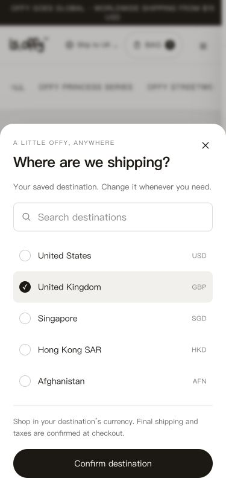
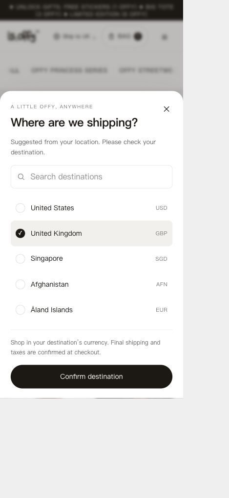

# 国家选择与判定验收（2026-11-09）

变更：`ship-to-country-resolution`。范围为国家推荐/选择、购物袋核对、过期国家结账拦截与可选 IP 库更新。不改商品、库存、运费、订单或 Collabs 计佣规则。

## 逻辑验证

- 最终完整 `pnpm test --maxWorkers=2`：139 文件 / 871 测试全部通过。
- 可信国家头、真实 IP/IPv6、Cookie 优先级、地理时区、区域语言、US 默认及损坏信号均覆盖。
- 设置接口覆盖同源限制、Shopify 可选国家验证、自动 session/manual 90 天 Cookie，以及真实 Set-Cookie 线值的下一请求回读。真实浏览器发现的二次编码问题已修复并回归。
- 购物袋保留身份/数量、缺失行无旧事实、完整小计/结账阻断、过期国家 409 诊断覆盖。
- MMDB 缺失、首次加载、损坏更新保留最后有效读取器覆盖。凭据文件不入 Git/镜像/客户端。
- 早期将完整测试与构建同时运行时，既有部署脚本测试发生资源竞争超时；停止并发后串行全量通过，没有放宽原测试超时或改部署业务逻辑。

## 浏览器验证

使用隔离本地生产服务，关闭营销上报，不创建 Shopify cart 或订单。

- 首次浏览器地理时区得到 China；币种 HKD 来自店铺现有 Shopify 配置。
- 搜索并确认 United States 后显示 USD 商品价；Cookie 下一次页面请求保持选择。
- 切换保留完整 `?dt_id=3689395&market_check=1#looks`。
- 真实美国专属 COLD KITTEN：US $49.90 加袋后切 GB，保留数量 1；显示通用不可用行、小计“—”、禁用 Checkout。切回 US 恢复 Shopify 名称、图片及 $49.90。测试行已移除。
- 桌面短窗口弹层 CTA 完整可见；375×812、320×640 无横向溢出，确认按钮 48px 高，标题初始焦点不弹手机键盘。取消不改变国家。
- 美国专属详情切 GB 后返回 404 状态并显示品牌化缺失页，仍可打开 Ship to，并保留 Header/购物袋/返回可售目录入口。
- 国家/币种名单来自当前 Shopify localization，失败时不伪造选项。

## 发布状态

已于 2026-11-09 20:31（上海时间）完成主站独立发布。运行代码提交 `3ad93a2a1de068d1a48de71d430af9799eb2eb01`；[原生 Linux CI](https://github.com/perrywang123/offywebsite/actions/runs/42616683286) 完成镜像、数据库原生绑定及迁移校验。隔离候选容器通过真实 Shopify localization / 偏好 Cookie 下一请求回读 / 商品目录页面验证后替换 app；服务器未执行编译。

线上 `https://isoffy.com/products` 正常，Ship to / 搜索 / 移动端面板可用。现有购物袋 DOTTY DARLING 数量 1、£33.90 保持完整；未在生产增加测试商品、调用结账创建接口或支付订单。线上检查只打开、搜索并取消选择，没有改变用户原有 GB 目的地。

比较发布前后 Docker 容器 ID、启动时间、镜像、环境键值哈希、挂载及 `.env` 哈希：后台、KOL worker、Meta worker 完全未变；app 既有凭据和数据卷未变，仅增加可选 GEO 配置。Nginx 未更新。已保留旧主站镜像和一致性 SQLite 备份 `/data/deploy-backups/offy-2026-11-09T12-31-43-230Z-5b0adefe.db`。

## GeoLite 自动更新激活（2026-11-10）

已完成 MaxMind 注册、邮箱验证、GeoLite 协议接受和 Offy 专用许可密钥创建。根据实际发布周期将检查间隔从 24 小时改为 72 小时：启动时立即检查，之后休眠 72 小时，有新版才下载。更新配置提交 `18c7bbf` 已推送 Git 并由服务器 `git pull --ff-only` 拉取，再执行 `bash deploy/update-geoip.sh`；没有手动修改服务器源码，也没有在服务器编译。

- 于 2026-11-10 18:07（上海时间）首次下载成功，文件 `/data/GeoLite2-Country.mmdb` 为 3,392,927 字节，元数据类型 `GeoLite2-Country`，库版本时间 `2026-11-06T06:16:28Z`（当天更新服务器返回的版本）。日志进入 `Sleeping for 72 hours`，重启次数为 0。
- 在主站容器内以实际运行用户 UID 1001 读取文件，权限 644；只读解析验证 `8.8.8.8 → US`、`81.2.69.142 → GB`。生产镜像将 MaxMind 解析器打包进 Next.js，验证脚本临时在本地打包后通过标准输入执行；没有向生产安装依赖或修改应用文件。
- 真实主站 `GET /api/market?context=1` 的 IP 判定返回 US / source=ip；公网 `https://isoffy.com/` 为 HTTP 200，健康接口正常。
- 接入前后比较主站、后台、KOL worker、Meta worker 的容器 ID、启动时间、镜像、环境哈希、挂载、端口及 `.env` 哈希，全部相同。仅新增 `geoipupdate`，CPU 上限 0.1、内存上限 96 MiB；没有新增公开端口。
- 凭据目录为 700、凭据文件为 600；密钥通过 SSH 私密传送，临时传输文件已删除，未输出完整密钥。私密目录继续从 Git、Docker 和便携源码包排除；国家库只保存于持久数据卷，不入库或镜像。未修改 Nginx、Shopify 商品、库存、订单、付款或用户购物袋。
- 新增部署检查覆盖 72 小时间隔与仅启动 updater 的调用边界。完整 `pnpm test --maxWorkers=2`：140 文件 / 873 测试全部通过；新增文件 ESLint、修改文件 Prettier 和 OpenSpec 校验通过。本次没有应用运行代码变化，无需重新构建主站或后台。

国家库每分钟最多检查一次文件变化并热读取，已保存的访客国家保持稳定。此处的 72 小时指更新服务访问 MaxMind 的间隔，用户每次访问仍查询本地国家库，不发送访客 IP 给 MaxMind。

仓库全量 Prettier 检查仍命中 67 处既有格式问题（主要历史 OpenSpec），本次改动文件单独检查通过；未批量改写历史规范。
