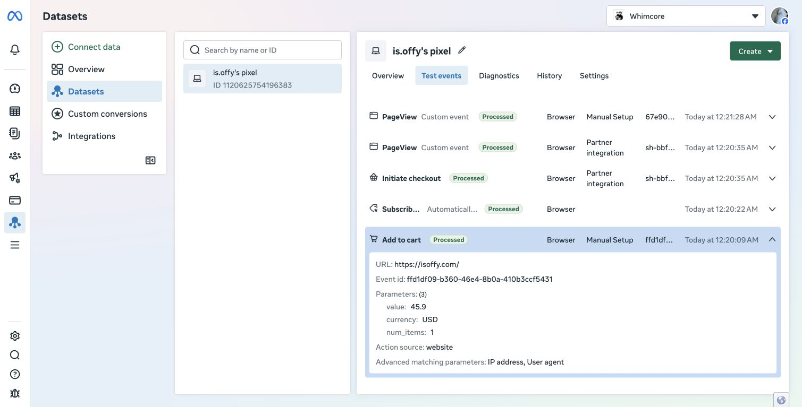

# Meta 生产发布与验收记录

日期：2026-11-08 至 2026-11-09（Asia/Shanghai）。状态：生产 Pixel / CAPI 已开启，主站、后台和独立 worker 已部署并验证。真实广告购买归因与商品目录匹配仍待独立验收。

## 已完成的准备

- 功能源码为 Git 提交 `a91c50452a8aa3f91aacbfb598ad6e88721ed679`，服务器通过 Git 快进获取。发布前无 tracked 本地修改。
- 服务器发布前主站和后台均健康；可用内存约 1.7 GiB，未达到默认构建预算加预留内存的门槛，因此不在生产服务器编译。
- 本机使用该提交的 Git archive 构建 Linux amd64 镜像，没有把本地私密 `.env` 放入构建上下文。首次国际源下载较慢，随后临时通过 Debian 官方镜像名单中的 USTC 镜像站以 HTTPS 下载构建包；Debian 签名校验保留，源码和服务器网络设置不变。
- 镜像 `sha256:a56c57544c70db2999dd3e81d041acfcdf04abc93c720fe9a4aea2d2972df30c`；OCI revision 与功能提交一致。Linux 构建的 lint、Next 类型检查、23 页生成和 standalone traces 均通过。
- 独立临时容器验证：`process.arch=x64`，数据库迁移成功，SQLite `integrity_check=ok`，`meta_events` 表存在，GeoIP 数据可加载，Next 服务健康接口返回200。临时容器已删除，没有使用生产数据库或创建真实订单。
- 压缩镜像 SHA-256：`d62d27bd139afdd6ecff6a594d2c327b9de60c8a5f5d10ceb7501c3fff7411cb`。完整上传后，服务器校验一致再导入；未使用此前未传完的文件。
- 服务器私密配置、运行容器信息和旧镜像回退标记已保留在 `.deploy-backups/meta-a91c504/` 及 `offy-app:pre-meta-a91c504` / `offy-admin:pre-meta-a91c504`；不提交其中的凭据或数据库。
- 本次从已构建镜像分别发布主站及后台，没有在服务器执行 Next 编译。两次替换前都保存了一致性 SQLite 备份；主站发布只替换 app，后台发布只替换 admin 与原 KOL worker。最后由独立命令启动 Meta worker，复用正在运行的主站镜像。

## Meta 与 Shopify 设置

已只读核对 Shopify Facebook & Instagram：数据共享为“增强”，数据集为 `1120625754196383`，已绑定1个广告账户。未改动此配置、支付密钥、市场、优惠、订单或 Collabs 计佣。

用户确认后已提交并完成 `contact@whimcoreofficial.com` 的企业通知邮箱验证；没有勾选营销邮件。随后按授权生成不含 Dataset Quality API 的直接接入 CAPI 令牌，通过隐藏输入脚本保存到服务器私密 `.env`，未放入 Git、镜像或截图。运行中的主站及后台均已读取新配置，数据集为 `1120625754196383`，Pixel / CAPI 开关均为 true。生产未设置全局 `META_CAPI_TEST_EVENT_CODE`。

单独发送一次带 Meta Test Events 测试码的合成 `TestEvent`，不包含买家信息，不代表加购或购买。Meta 返回 HTTP 200、`events_received=1`，页面显示 Server / Processed。这只证明凭据与服务器传输可用，实际购物事件另行验证。

## 生产交互与事件证据

Chrome 打开生产商品列表，携带内部验证标签 `utm_source=offy_validation&utm_medium=internal_test&utm_campaign=meta_production_20261108`。使用正常 Shopify 隐私运行时，未注入许可模拟参数或编造 fbclid。当前地区没有展示需要操作的许可横幅；拒绝、撤回及手机布局的隔离验证仍见 [原验收记录](meta-validation.md)，本次不冒记为新增的生产地区许可验收。

进入 DOTTY DARLING（`/products/black-pearl`），实际加购 1 件，点击 Checkout 并抵达 Shopify 托管结账。站内、购物袋及结账均为 **USD 45.90**。结账正常展示商品和输入表单；没有输入买家、地址或付款资料，没有提交订单。返回 Offy 后购物袋为原来的 0 件。

| 事件             | 证据                                                                                                 | 结果                                                   |
| ---------------- | ---------------------------------------------------------------------------------------------------- | ------------------------------------------------------ |
| PageView         | 生产数据库观察及 Meta Test Events Browser                                                            | Processed                                              |
| ViewContent      | 商品页，1 件 / USD 45.90；Meta Browser                                                               | Processed                                              |
| AddToCart        | Browser 与 CAPI 使用同一编号 `ffd1df09-b360-46e4-8b0a-410b3ccf5431`；Meta 页面金额 / 币种 / 数量一致 | CAPI 第 1 次发送成功，`sent`、无错误                   |
| InitiateCheckout | 编号 `97fe77da-816c-4c17-993c-cf295c67bc9f`，关联结账诊断 `ffbef13a-3c63-4d15-bf22-0649a1338ab3`     | CAPI 第 1 次发送成功，`sent`、无错误；Shopify 结账可用 |

后台真实登录后，`/admin/meta` 能筛选「CAPI 已接收」，展开实际内部测试来源、发送次数与事件编号。CAPI 的 `sent` 由 Meta HTTP 成功及 `events_received=1` 共同决定，不是仅入队就显示成功。生产关键事件没有附测试码，因此不能拿 Test Events 中的合成 Server 事件代替它们的正式接收回执。

Meta 同时显示 Shopify 官方 Partner integration 的托管结账 `Initiate checkout`，其编号与 Offy 结账准备事件不同。不能声称这两条已跨集成去重，也不能把结账事件总数当订单数。本次未改 Shopify 官方集成或购买链路；若以后需要严格去重的结账漏斗，应另行确定统一事件责任及验收方案。Offy 没有新增 Purchase 上报。

[后台 CAPI 接收与来源](design/meta-production/admin-capi-received.png) · [托管结账展示](design/meta-production/hosted-checkout.png) · [连接测试 Server 已处理](design/meta-production/capi-test-processed.png)

## 发布后稳定性

主站与后台健康检查通过，KOL 原 worker 就绪检查通过。四个服务均使用上述功能版本对应镜像，重启计数为 0；数据库 `integrity_check=ok`。私密 `.env` 的非 Meta 配置逐行比较一致，Nginx 原配置 SHA-256 未改变，发布脚本也通过了已有 HTTPS 主站 / 后台入口边界检查。

资源采样：可用内存约 1.98 GiB；主站 CPU 约 10%、后台约 0%、Meta worker 约 0.16% / 16.09 MiB。worker 限制为 0.25 CPU、96 MiB。这些是时点采样，不是压测或长期 SLA；本次没有服务器编译任务。

## 仍需单独验收

- 目录映射当前为 0 项。浏览、加购和结账金额事件已发送；动态商品广告及商品级匹配需要核对 Meta 目录实际 retailer/content ID 后配置，不能用猜测 ID。
- 真实 Shopify 官方 Purchase、Browser / Server 平台最终去重指标，以及真实广告点击到购买的归因。这次未授权新增付款测试，没有发布广告或创建真实订单。
- 其他地区的生产许可横幅、拒绝和撤回体验；本轮已执行的隔离边界测试不能代替全部地区的生产测试。

真实 Shopify Purchase、真实广告互动归因及目录匹配属于独立验收层级。不得将本地协议通过或服务器接收回执写成真实广告购买归因已通过；不为验证而发布广告或重复付款。

## 2026-11-09 后续只读核对与飞书交付

商品目录 `1430885911973275` 已存在，共41个商品，数据集关联正确。DOTTY DARLING 的 Content ID `53547250549025` 与 Offy 的 `/products/black-pearl` 相对应；目录显示 SGD55.90 和 Shopify 商品域名，Shopify 目录设置显示新加坡市场。目录 Events 的匹配率为0%，Actions 的1项问题也是商品未匹配广告事件。目录 ID 映射、目标投放市场/币种和 Offy 落地链接仍需一起适配；没有在本次只读任务中修改目录、商品、市场或线上配置。

Meta 正式总览（日期筛选 `2026-11-08`）可见 Purchase Active、Browser / Server、匹配质量8.0/10、处理前事件2条；Diagnostics 显示暂无活动错误。已能观察到官方购买实收，但具体订单金额/币种、最终去重及真实广告归因仍未完成受控核对，不能按2条事件认定2笔广告订单。

[飞书图文 SOP](https://my.feishu.cn/wiki/L0Ptw9zhHiVj7akJcG3cRwFenLy) 已创建，包含 Shopify、目录商品/匹配、Meta 测试/正式事件、Ads Manager 报表/指标选择、Offy 后台共8张截图。重新打开并逐节读取，确认8张不同图片均已保存且正常加载；正文使用原生标题、列表、指标表和检查清单。本次没有发布广告、调整预算、提交订单、修改支付或重新部署服务。

## 2026-11-09 现有目录映射上线

在后续明确授权的配置任务中，已将现有目录41件商品的真实ID映射写入生产主站和后台；同一镜像无构建重载，保留原内部认证、worker、数据库和Nginx。美国实际加购和发起结账携带目录ID，CAPI首次发送成功；托管结账展示USD91.80（2件），未提交订单，原购物袋已恢复。Meta的广告链接域名规则与默认美国地区已保存，地区价格覆盖及实际链接下一次同步后的生效仍待验收。没有新增商品或目录。详见 [完整配置验收及边界](meta-catalog-activation-validation.md)。飞书SOP已补充最新状态和3张上线截图；前节只读记录保持其原有时间边界。
