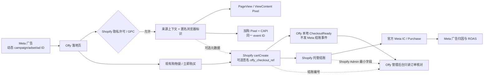

# Offy Meta 追踪与订单证据技术方案

更新：2026-11-14。按 OpenSpec + TDD 实现；[操作简版](meta-ads-sop.md)、[详细版](meta-ads-sop-detailed.md)、[订单链路验收](meta-order-trace-validation.md)、[可靠性修复验收及上线状态](meta-reliability-validation.md)。

## 整条链路

## 上报分工与兼容

Offy 浏览器只发 PageView、ViewContent、AddToCart；CAPI 只补 AddToCart。浏览器与服务器同一次加购共用 event ID，重试不换 ID、不改原时间。Shopify 官方独占 InitiateCheckout/Purchase，Offy 不另发购买事件；站内成功生成跳转链接只记 CheckoutReady。保留旧 InitiateCheckout 接收/明细兼容，但不再入 CAPI；旧待发/发送中结账任务改为 suppressed，保留历史。

复用 Shopify Customer Privacy：analyticsProcessingAllowed、marketingAllowed、saleOfDataAllowed 全部允许且无 GPC 才处理营销数据。拒绝时购物继续；撤回删除营销观察及其关联订单证据，不删 Shopify 订单。URL 只留 pathname、白名单来源标签；不记录买家邮箱、地址、支付资料。真实 fbclid/_fbc 保留原时间，最多30天，不猜广告点击；新来源标签整体替换，不能混合上一次 ad_id。

## 观察可靠性修复

浏览器上报使用同页内存队列：最多50条、并发2、每条最多3次尝试、最长60秒，重试网络/4秒超时/429/5xx，保持原 event ID、时间和请求体，仅重试本地观察请求。许可撤回、身份过期或禁用时取消；购物与托管跳转不等待该队列，关闭页面不保证送达。

出现任何新有效标签时整体替换旧来源，不混入旧 ad_id；URL 没有任何有效标签时保留原来源。fbc 的真实点击独立更新，不将保留标签解释为新点击的已知广告。受控 Meta paid_social 的纯数字 utm_campaign/content/term 可补缺失的 campaign/ad/adset ID，显式 ID 优先；写入、历史筛选和展示采用一致规则，不改写历史记录。

内测标签在浏览器阻止 Pixel 初始化/发送，在服务端不创建 CAPI 载荷，并抑制历史 pending/sending 内测任务，历史 sent 结果保留。漏斗只对同路径首屏 ViewContent→PageView 的最多2秒倒序放宽，保留缺失事件、跨页面及结账/订单时间约束。未许可前的访问、Meta最终归因和已发历史测试无法由这些修复回补。

## 可选结账元数据

现有结账请求承载许可内的匿名上下文，成功创建购物车后服务端记录本地观察，避免离站 beacon 丢失。不增加跳转步骤和 Meta 外部调用。商品选择、数量、国家、折扣、原 Shopify checkoutUrl、buy-now 与购物袋回跳规则保持。元数据生成、签名或持久化失败只降级记录，不能阻止结账。

将随机结账 UUID 以域隔离 HMAC 签名作为 Shopify 官方支持的 cart attribute `offy_checkout_ref`；它不是购买证明或 Meta 参数。只用现有诊断密钥签名，不新增商户密钥体系。仅在诊断可用及许可上下文存在时能形成后续关联。

## 订单读取及证据存储

新增 SQLite `meta_order_evidence`、`meta_order_sync`，可加迁移。**管理后台 KOL worker**复用现有 Shopify Admin API 认证，只执行 orders query；不向主站注入 Admin Client Secret，不修改订单、商品、支付或 Collabs。每轮最多25笔、8秒HTTP超时、持久租约和游标；首次回看30天，完成扫描后15分钟检查、5分钟重叠，失败5分钟后重试。分页有下一页时至少间隔10秒继续，不能跳过未读页。

只有签名有效、仍有许可内结账观察、时间合理的订单落库；按 Shopify ID 幂等覆盖，较旧 updatedAt 不能覆盖新版退款/取消。保存最少订单字段：编号、时间、财务状态、取消/测试标记、金额币种和结账编号；不保存完整客户信息或原签名。撤回后不能重新导入；保留期最多30天，接收器/worker清理孤立证据。Admin凭据不可用只影响订单核对，CAPI与购物仍运行。

## 后台与口径

`/admin/meta` 和 trace API 均在现有可信入口及登录后访问，no-store/noindex。默认近7个上海日历日、最多30天，默认排除 `utm_source=offy_validation` 或 `utm_medium=internal_test` 以及 Shopify 测试订单。显示观察次数、匿名浏览器标识数、来源 ID、CAPI 结果；展开同浏览器最多50条观察与对应结账/订单，展示截断提示。汇总按币种，含运税的订单总额和退款分开，不做净利润、ROAS、最终归因或佣金推断。

链接助手仅生成广告 URL parameters 模板，不编辑或发布广告。Meta Ads Manager 仍是广告归因/花费/ROAS的最终入口；自然访问、标签及CAPI回执都不能证明真实广告购买归因。

## 发布及回退

测试、类型、lint、本地生产构建及隔离浏览器交互先完成。Git同步后在构建机/CI打Linux amd64镜像，校验Git revision、架构和校验和，再分别发布主站/后台，避免2核服务器编译。切换前停止旧 Meta worker；新主站健康后复用新镜像启动。数据库/镜像备份，现有Nginx与私密配置保留。旧浏览器未导航前可能仍执行旧Pixel；不强制刷新客户、不改历史数据。

只读订单故障看后台最近成功/错误状态；可停止对应worker或关闭营销开关而不修改支付密钥。技术接收验收、模拟全链路与真实广告互动成交分层报告；不将未执行的真实订单或Meta最终去重写为已通过。

依据：[Shopify 隐私 API](https://shopify.dev/docs/api/customer-privacy)、[Shopify Meta 数据共享](https://help.shopify.com/en/manual/promoting-marketing/analyze-marketing/meta-data-sharing)、[Shopify Admin Order](https://shopify.dev/docs/api/admin-graphql/2026-07/objects/Order)。
