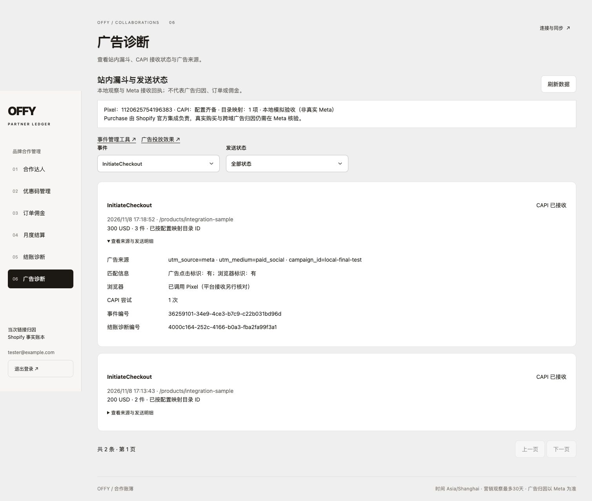

# Meta 漏斗实施与隔离验收记录

2026-11-08。本次范围为 [技术方案](meta-technical-plan.md) 的 Pixel 站内漏斗和购买前关键事件 CAPI，按 OpenSpec / SDD 先定义行为，再进行失败测试、实现与页面验收。

## 已验证

完整测试套件串行通过：128 个文件、853 项测试。覆盖许可与撤回、来源清理、事件白名单、真实价格/币种与增量数量、事件去重、加密保存、租约和有限重试、永久错误、匿名接口边界，以及追踪异常不阻断购物。此前并行运行构建和测试时两项部署脚本测试超时；停止资源竞争后完整重跑通过，没有调大超时或跳过测试。最终 `pnpm typecheck`、`pnpm build`（包含 lint 和 Next 类型校验）均通过；构建成功完成静态生成与 standalone traces。

部署辅助脚本通过 `python3 scripts/meta-deployment-checks.py`：验证配置文件权限、隐藏令牌输入、原 Shopify 配置保留、空输入保留已有值，以及 worker 使用健康主站的实际镜像、`--no-build --no-deps` 且不重启主站/后台。此项使用命令模拟，没有执行生产 Docker 发布。

页面验收使用独立端口、临时 SQLite、模拟 Shopify 及本地 Pixel/CAPI 接收器。真实 Meta 请求为零，创建的真实订单为零；以下证据不冒充外部平台验收。

- 接受许可后，浏览商品、实际加购和发起模拟托管结账正常；AddToCart 的 Browser/Server 编号一致，金额 USD 100、实际增加 1 件。已有购物袋另有 2 件，所以该次 InitiateCheckout 为 3 件、USD 300，并关联成功创建结账的诊断编号。
- 模拟 CAPI 返回成功后，后台显示已接收并清除已完成任务的加密匹配 payload；没有发送 Purchase。[协议核验记录](design/meta-funnel/protocol-proof.json)
- 拒绝营销许可后没有加载 Pixel 脚本，Pixel 计数保持 12、CAPI 保持 6；继续加购、结账仍可到达明确标注 No real charge 的模拟 Shopify 页面。[许可核验记录](design/meta-funnel/consent-proof.json)
- 管理后台可筛选/展开事件，查看来源标签、金额币种、发送状态和结账诊断编号；不会返回原始浏览器匹配标识或令牌。375px 手机视口的页面宽度与文档宽度均为 375，无横向溢出。

## 页面证据

[手机广告诊断](design/meta-funnel/admin-mobile.jpg) · [购物袋](design/meta-funnel/cart.jpg) · [模拟结账](design/meta-funnel/mock-checkout.jpg) · [拒绝许可后仍能结账](design/meta-funnel/denied-checkout.jpg)

验收结束后已关闭本次临时浏览器标签、恢复视口、停止临时服务，并删除本次临时数据库与密钥。未清理用户原有数据库、截图或服务。

## 尚需生产配置后核验

后续进展：2026-11-08 至 11-09 已单独完成生产配置与发布，并验证 Meta Browser 实收和关键事件 CAPI 接收；见 [生产验收记录](meta-production-validation.md)。以下段落保留本次隔离验收时的范围，不代表当前生产仍未启用。

本轮没有部署生产、注入真实 Meta 令牌、发布广告或改变 Shopify 支付配置。代码默认关闭追踪。真实 Meta Test Events 接收、目录匹配、平台去重，以及 Shopify 官方 Purchase 和真实广告互动的归因，需要管理员按 [投放与看数 SOP](meta-ads-sop.md) 的清单继续验收。

本地协议成功、CAPI 接收回执和 Meta 广告归因是不同证据。此版本保留 Shopify 官方 Purchase 责任，不另外发送 Purchase，也不根据浏览器回跳认定付款或生成 KOL 应付佣金。
